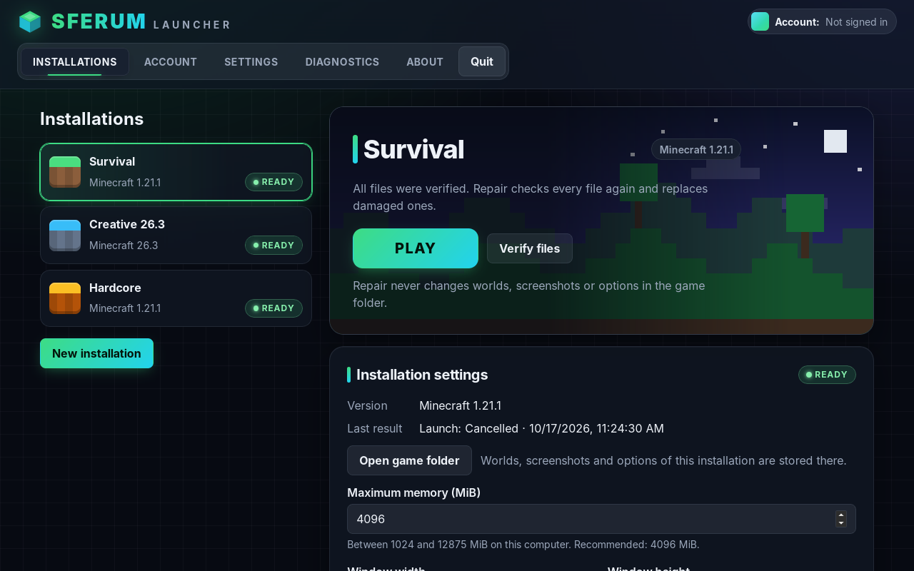

# Sferum Launcher

An independent desktop launcher for Minecraft: Java Edition, built with Tauri 2, React,
TypeScript and Vite on a Rust core. "Sferum Launcher" is a provisional name.

> Sferum Launcher is an independent project. It is not affiliated with or endorsed by
> Mojang Studios or Microsoft. It does not include or redistribute any Minecraft game files.



## Status

Implementation follows the phased specification in [`docs/spec/`](docs/spec/README.md).
The single progress tracker is [`docs/spec/PROGRESS.md`](docs/spec/PROGRESS.md); the
evidence is in [`docs/VERIFICATION.md`](docs/VERIFICATION.md).

**What works (verified on Linux x64):** creating installations of the supported releases
(Minecraft 1.21.1 with Java 21 and 26.3 with Java 25), installing them from the official
Mojang and Adoptium sources with digest verification, a shared verified cache, cancel,
resume and repair, a private Java runtime per version (Mojang's own runtimes by default,
Eclipse Temurin as a choice in **Settings → Java**, D-036), the launch compiler (real Java
accepts the real arguments of both versions), game supervision with window unload and
return, a live console window with the launcher's journal and the game's output
(Ctrl+Shift+L, D-037), diagnostics export, one Settings screen for the launcher and every installation,
and packages for Windows, macOS and Linux built and
smoke-tested in CI. Every vanilla version Mojang lists can be installed: releases,
snapshots, beta, alpha and Classic, each type on its own tab (D-035). Versions before 1.19
need an Intel Mac or Windows/Linux; Apple silicon runs 1.19 and later.

**Without an account:** **Play demo** starts Minecraft's free demo (five in-game days, no
multiplayer) under a local player name, in every build (D-033).

**What does not work yet:** playing the full game. The project's Microsoft application is
registered and packages are built with its client ID, but Minecraft services have not yet
approved it, so a sign-in is expected to end with their refusal until then; no account
has been verified yet
([`docs/AUTH-SETUP.md`](docs/AUTH-SETUP.md)). Full play always goes through the signed-in
account and its fresh access check. For automated tests, debug builds can route every
launch to the demo with a test profile
([`docs/DEVELOPMENT.md`](docs/DEVELOPMENT.md#test-profile-debug-builds-only), D-030).

**Not qualified yet:** real Windows, macOS and Wayland machines, real accounts and signed
packages. The MVP is not complete until those checks pass (P13 in
[PROGRESS.md](docs/spec/PROGRESS.md)).

### Known limitations

- Packages are unsigned private qualification builds; Windows SmartScreen and macOS
  Gatekeeper warn before opening them ([`docs/INSTALL.md`](docs/INSTALL.md)).
- On Linux each unload/return cycle of the window keeps two WebKitGTK file descriptors
  open until the launcher exits (about 490 game sessions per launcher run; D-029).
- The AppImage uses the host's glibc (2.36 or newer), graphics and audio libraries.
- The launcher has no automatic updater; install newer packages over older ones.
- No license has been chosen for the source yet (D-010).

## Quick start

Prerequisites (details in [`docs/DEVELOPMENT.md`](docs/DEVELOPMENT.md)): Node.js 24.21.0
(`.nvmrc`), rustup (the toolchain is pinned in `rust-toolchain.toml`) and the Tauri system
dependencies for your OS.

```sh
npm ci
npm run tauri dev      # run the desktop app with hot reload
npm run check          # typecheck, lint, format check, frontend + Rust tests, clippy
npm run tauri build    # release build and installers for the current OS
```

## Documentation

| Document                                           | Purpose                                                               |
| -------------------------------------------------- | --------------------------------------------------------------------- |
| [docs/DEVELOPMENT.md](docs/DEVELOPMENT.md)         | Developer setup, scripts and project layout                           |
| [docs/AUTH-SETUP.md](docs/AUTH-SETUP.md)           | Microsoft application registration and service access (owner actions) |
| [docs/INSTALL.md](docs/INSTALL.md)                 | Installing, updating and uninstalling the packages                    |
| [docs/PACKAGING.md](docs/PACKAGING.md)             | Package builds, checksums, smoke tests and signing (owner actions)    |
| [docs/RELEASE-NOTES.md](docs/RELEASE-NOTES.md)     | Changes, compatibility and package references per version             |
| [docs/TROUBLESHOOTING.md](docs/TROUBLESHOOTING.md) | Common problems and what to do                                        |
| [docs/DECISIONS.md](docs/DECISIONS.md)             | Decision records and deviations                                       |
| [docs/VERIFICATION.md](docs/VERIFICATION.md)       | Actual check results per phase, host and commit                       |
| [docs/spec/](docs/spec/README.md)                  | Product specification v1.2.1 and phase plan                           |

Minecraft is a trademark of Mojang Synergies AB. Use of the game is subject to the
[Minecraft EULA](https://www.minecraft.net/en-us/eula).
